# BinaryToText 사용설명서

BinaryToText 는 구조를 모르는 바이너리 파일을 사람이 읽을 수 있는 텍스트로 바꾸는 Windows 프로그램입니다.
인터넷과 브라우저 없이 동작합니다.

- 직접 찾아낸 규칙("`09` 가 나오면 `00` 까지 문자열")을 표로 만들어 적용하거나
- TLV, Protobuf, MessagePack 같은 **이미 알려진 형식**으로 해석하거나
- **자동 분석**으로 형식과 태그 후보를 추정할 수 있습니다.

> 이 설명서의 화면은 `examples\manual\` 의 예제 파일로 만들었습니다. 같은 파일을 열어 보면서 따라 할 수 있습니다.
> 화면은 `docs\make_screenshots.py` 로 다시 만들 수 있습니다.

## 목차

1. [설치와 실행](#1-설치와-실행)
2. [화면 구성](#2-화면-구성)
3. [파일 열기와 결과 보기](#3-파일-열기와-결과-보기)
4. [규칙 만들기](#4-규칙-만들기)
5. [헤더와 꼬리](#5-헤더와-꼬리)
6. [모르는 파일 해독하기 (반복 작업)](#6-모르는-파일-해독하기-반복-작업)
7. [자동 분석 (F6)](#7-자동-분석-f6)
8. [내장 포맷으로 해석하기](#8-내장-포맷으로-해석하기)
9. [규칙 폴더와 자동 선택](#9-규칙-폴더와-자동-선택)
10. [결과 저장](#10-결과-저장)
11. [여러 파일 한 번에 변환](#11-여러-파일-한-번에-변환)
12. [명령줄 (btt.exe)](#12-명령줄-bttexe)
13. [단축키와 참고표](#13-단축키와-참고표)

---

## 1. 설치와 실행

1. [릴리스 페이지](https://github.com/kisubkim/BanaryToText/releases)에서 `BinaryToText-<버전>-win64.zip` 을 받습니다.
2. 원하는 곳에 압축을 풉니다.
3. `BinaryToText\BinaryToText.exe` 를 실행합니다. 설치나 Python 은 필요 없습니다.

| 실행 방법 | 동작 |
|---|---|
| `BinaryToText.exe` 더블클릭 | 빈 창으로 시작 |
| 파일을 `BinaryToText.exe` 아이콘에 끌어다 놓기 | 그 파일을 열어서 시작 |
| 파일 여러 개나 폴더를 아이콘에 끌어다 놓기 | [여러 파일 변환](#11-여러-파일-한-번에-변환) 창이 열림 |

처음 실행하면 아래처럼 빈 화면과 함께 **예시 규칙**(`09` 문자열, `04` 정수, `0A` 배열) 3개가 들어 있습니다.

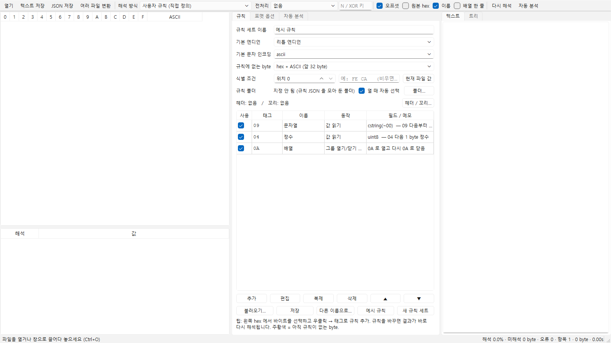

---

## 2. 화면 구성

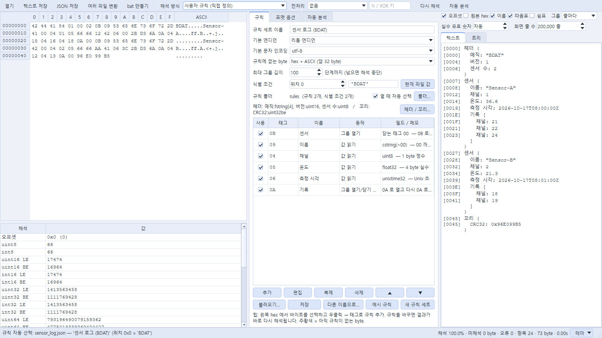

| 위치 | 이름 | 하는 일 |
|---|---|---|
| 맨 위 | **툴바** | 열기, 저장, 여러 파일 변환, bat 만들기, 해석 방식, 전처리, 다시 해석(F5), 자동 분석(F6) |
| 왼쪽 위 | **hex 보기** | 파일의 byte. 주황색 = 아직 어떤 규칙에도 맞지 않은 byte, 파란색 = 지금 선택한 항목 |
| 왼쪽 아래 | **데이터 해석기** | 커서 위치의 byte 를 정수(8~64bit, LE/BE), 실수, 시각, 문자열 등으로 한꺼번에 보여 줌 |
| 가운데 | **규칙 / 포맷 옵션 / 자동 분석** 탭 | 해석 방법을 정하는 곳 |
| 오른쪽 위 | **출력 설정** (두 줄) | 오프셋/원본 hex/이름/따옴표/쉼표/그룹, 실수 유효 숫자, 화면 줄 수 → [출력 모양 바꾸기](#출력-모양-바꾸기-결과-위-출력-설정) |
| 오른쪽 | **텍스트 / 트리** 탭 | 해석 결과 |
| 맨 아래 | **상태 표시줄** | 왼쪽: 최근 작업 메시지. 오른쪽: 해석률, 미해석 byte 수, 오류 수, 항목 수, 걸린 시간, **테마** 단추 |

**해석률**은 파일의 byte 중 규칙으로 설명된 비율입니다. 규칙을 다듬어 100% 에 가깝게 만드는 것이 목표입니다.

### 화면 테마

상태 표시줄 맨 오른쪽의 **테마** 를 눌러 화면 색을 바꿉니다. 바로 적용되고, 다음 실행에도 유지됩니다.

| 테마 | 느낌 |
|---|---|
| 파스텔 블루 (기본) / 파스텔 민트 / 파스텔 라벤더 / 파스텔 피치 | 연한 바탕에 흰 작업 영역. 툴바·탭·버튼이 색으로 구분됨 |
| 소프트 다크 | 눈이 편한 회청색 어두운 테마 (새까맣지 않음) |
| 레트로 터미널 | 검은 바탕에 초록 글자, 각진 모서리 |
| 세피아 종이 | 누런 종이와 갈색 글자 |
| Windows 기본 | 테마를 쓰지 않는 Windows 원래 모양 |

hex 보기의 주황색(규칙 없는 byte)과 파란색(선택한 항목)은 모든 테마에서 같은 뜻입니다.

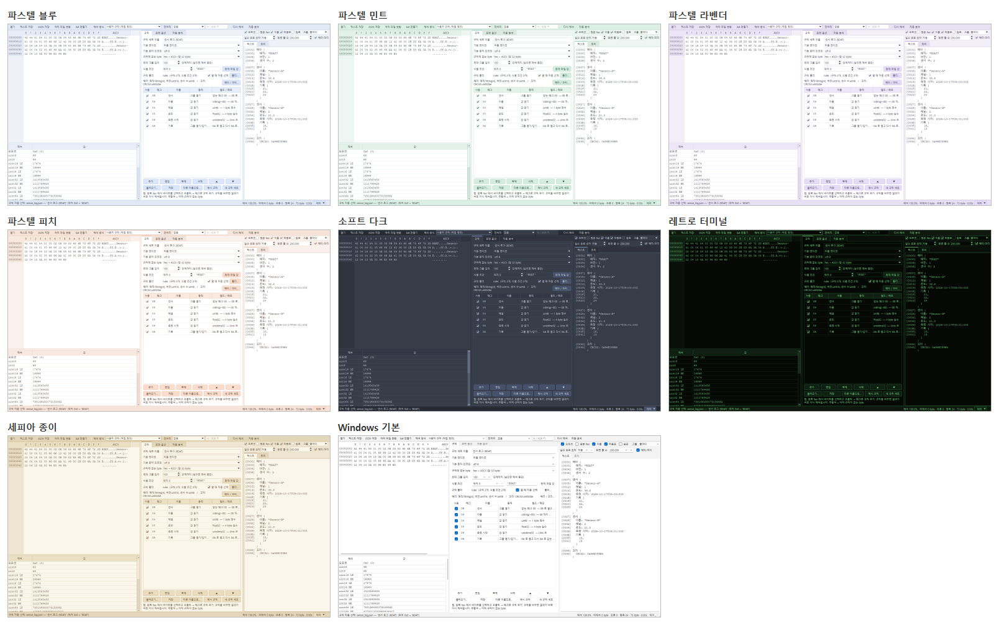

---

## 3. 파일 열기와 결과 보기

- **열기**: 툴바 **열기** (Ctrl+O) 또는 파일을 창에 끌어다 놓기. 규칙 JSON 파일을 끌어다 놓으면 규칙으로 불러옵니다.
- 파일을 열거나 규칙을 바꾸면 **바로 다시 해석**됩니다. 직접 하려면 F5.

### hex 와 결과가 서로 연결됩니다

- 결과 텍스트의 줄을 클릭하면 → hex 에서 그 항목의 byte 가 파란색으로 표시됩니다.
- hex 의 byte 를 클릭하면 → 그 byte 를 해석한 텍스트 줄로 이동합니다.
- 상태 표시줄 왼쪽에 커서 위치의 항목이 나옵니다 (예: `0x10: 이름 "Sensor-A"`).

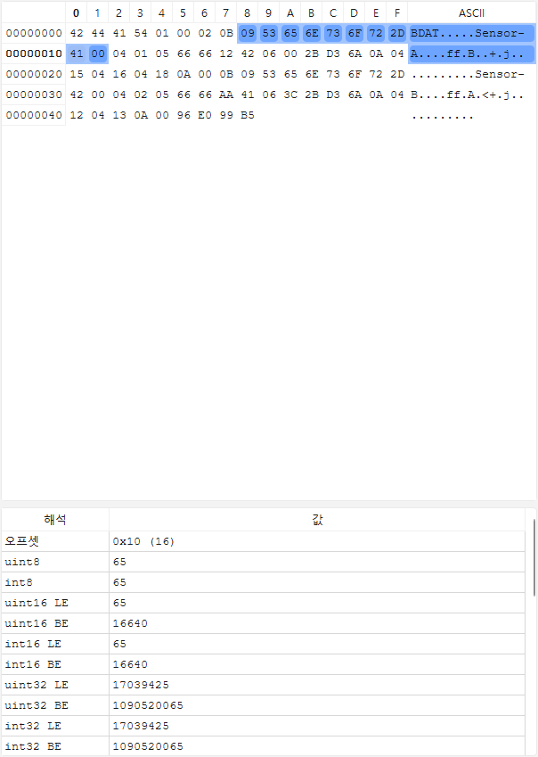

데이터 해석기는 규칙을 만들 때 특히 유용합니다. 어떤 4 byte 가 정수인지 실수인지 시각인지 모를 때,
그 위치를 클릭해서 어느 해석이 그럴듯한지 바로 볼 수 있습니다.

### 텍스트와 트리

결과 텍스트의 형식은 다음과 같습니다.

```
[0007] 센서 {                       ← [오프셋(hex)] 이름 + 그룹 괄호
[0008]   이름: "Sensor-A"           ← 값
[0014]   온도: 36.6
[0019]   측정 시각: 2026-10-17T08:00:00Z
[001E]   기록 [
[001F]     채널: 21
       ]
       }
```

- **트리** 탭은 같은 결과를 접고 펼 수 있는 표로 보여 줍니다. 항목·값·오프셋·길이 열이 있습니다.

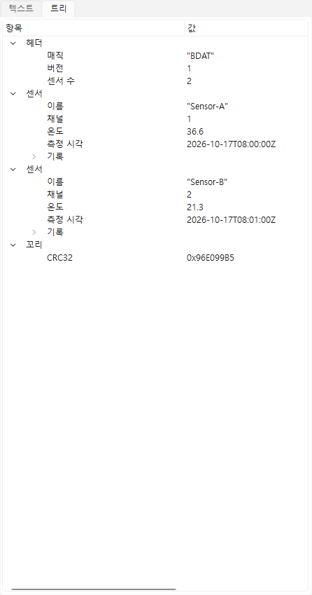

### 출력 모양 바꾸기 (결과 위 출력 설정)

오른쪽 **텍스트 / 트리** 탭 바로 위의 두 줄에서 정합니다.

| 설정 | 기본 | 설명 |
|---|---|---|
| **오프셋** | 켜짐 | 끄면 줄 앞의 `[0007]` 같은 위치 표시가 빠짐 |
| **원본 hex** | 꺼짐 | 켜면 각 줄 끝에 그 항목의 원래 byte 를 함께 표시 |
| **이름** | 켜짐 | 끄면 `온도: 36.6` 의 `온도:` 같은 **규칙 이름(라벨)을 빼고 해석된 값만** 출력. 괄호와 들여쓰기는 남아서 구조는 보임. 파일에서 읽은 키(`volume = 30`, 아래 [키 사용](#파일-속-문자열을-키로-쓰기-key--값))는 데이터이므로 그대로 남음 |
| **따옴표** | 켜짐 | 문자열을 `"Sensor-A"` 처럼 따옴표로 감쌈 (`key = "값"` 의 값 포함). 끄면 따옴표 없이 씀: `1, 2, abc, "", cde`. 단 **빈 문자열**(`""`)과 **공백이나 특수문자**(`, = : ; [ ] { } ( ) < > #`, 따옴표, `\`)가 든 문자열은 `"a b"` 처럼 따옴표를 남김 |
| **쉼표** | 꺼짐 | 켜면 그룹 안의 각 항목 뒤에 `,` 를 붙이고 다음 줄로 (마지막 항목 제외). 값만 쓰는 그룹(배열)과 한 줄 그룹은 항상 쉼표. 그룹 규칙의 **쉼표** 로 그룹마다 바꿀 수 있음 → [그룹마다 쉼표 정하기](#그룹마다-쉼표-정하기) |
| **그룹** | 줄마다 | 그룹 안 항목을 어떻게 쓸지 (아래 표) |
| **실수 유효 숫자** | 자동 | float/double 값을 몇 자리 유효 숫자로 쓸지 (아래 설명) |
| **화면 줄 수** | 200,000 줄 | 텍스트 탭에 보여 줄 최대 줄 수. 넘으면 잘라서 보여 줌. **화면에만** 적용되고 저장 파일에는 항상 전체가 들어감 |
| **헤더/꼬리** | 켜짐 | 끄면 규칙 세트의 헤더·꼬리(→ [5장](#5-헤더와-꼬리)) 그룹을 출력에서 뺌. 화면·저장 파일 모두 |

| 그룹 | 결과 |
|---|---|
| 줄마다 | 항목마다 줄을 바꿈 (기본) |
| 배열만 한 줄 | 값만 들어 있는 `[ ]` 배열만 `[21, 22, 24]` 처럼 한 줄로. 객체 `{ }` 는 줄마다 |
| 한 줄로 | 모든 그룹을 쉼표로 이어 한 줄로: `network = {ip = "192.168.0.10", port = 8080}` |

여기서 고른 모양은 화면, **텍스트 저장**, **여러 파일 변환** 에 똑같이 적용됩니다.
그룹마다 다르게 하고 싶으면(예: 객체는 줄마다, 배열만 한 줄) 규칙 편집 창의 **그룹 표시** 를 쓰세요 →
[그룹마다 표시 방법 정하기](#그룹마다-표시-방법-정하기).

| 이름 끔 + 쉼표 + 배열만 한 줄 | 이름 켬 + 배열만 한 줄 |
|---|---|
| 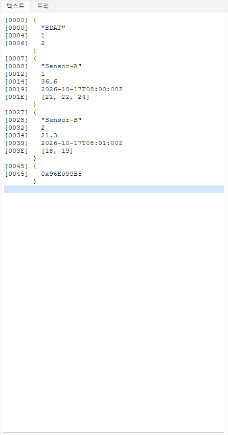 | 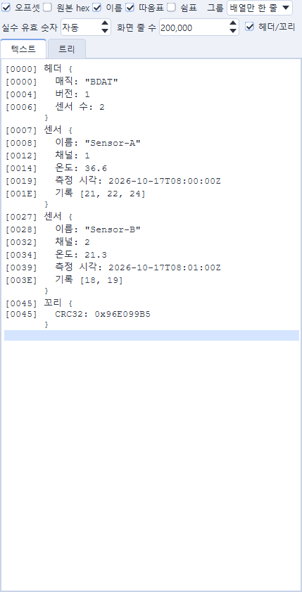 |

**실수 유효 숫자**: 기본 **자동** 은 값을 정확히 나타내는 가장 짧은 표기입니다. float32 로 저장된 36.6 은
실제로 36.59999847… 이지만 `36.6` 으로 나옵니다. 자릿수를 정하면 그 유효 숫자로 반올림합니다.

| 설정 | float32 36.6 | double 1/3 | 123456.7 |
|---|---|---|---|
| 자동 | `36.6` | `0.3333333333333333` | `123456.7` |
| 3 자리 | `36.6` | `0.333` | `123e3` |
| 9 자리 | `36.5999985` | `0.333333333` | `123456.7` |

- 사용자 규칙의 실수 필드와 내장 포맷(MessagePack, CBOR, BSON, UBJSON, Thrift, Protobuf)의 float/double 에 모두 적용됩니다.
- 화면, 텍스트·JSON 저장, 여러 파일 변환에 똑같이 적용됩니다. 명령줄은 `--float-digits N`.
- 왼쪽 아래 데이터 해석기는 항상 자동입니다.
- 아주 크거나 작은 값은 지수로 씁니다. 지수는 **항상 3의 배수**이고 `+` 나 앞자리 0 을 붙이지 않습니다:
  `0.00001234` → `12.34e-6`, `1.5e+07` → `15e6`, `2.5e-10` → `250e-12`. 유효 숫자의 개수는 그대로입니다.

**그룹: 한 줄로** + **따옴표 끔** (`key = 값` 예제 파일):

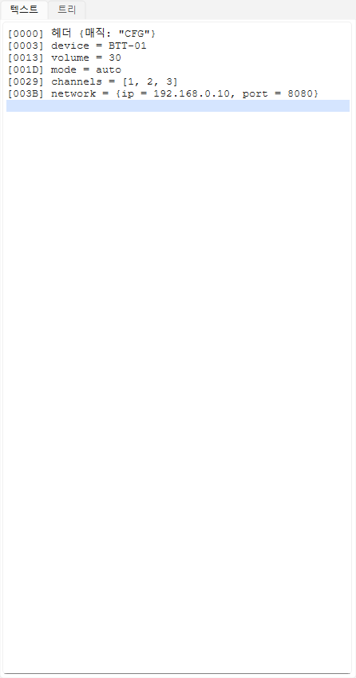

- 쉼표는 **그룹 안의 항목 사이**에만 붙습니다. 그룹 밖 맨 바깥 항목들에는 붙지 않습니다.
- 한 줄로 쓰는 그룹과 **값만 나열하는 그룹**(기본: 배열 `[ ]`)은 쉼표 체크와 상관없이 항상 쉼표로 구분합니다.
  그룹 규칙의 **쉼표** 를 "넣음" / "안 넣음" 으로 정하면 그 그룹은 체크와 상관없이 규칙을 따릅니다.
- 기본으로 **배열 `[ ]` 안에는 값만** 씁니다. 규칙 이름(`채널:`)도, `key = 값` 도 쓰지 않습니다(`기록 [21, 22]`).
  객체 `{ }` 안은 이름과 `key = 값` 을 그대로 씁니다. 그룹 규칙마다 바꿀 수 있습니다 →
  [그룹 항목: key = 값 또는 값만](#그룹-항목-key--값-또는-값만).
  값만 쓰는 그룹 안의 객체 `{ }` 는 이름 없이 `{` 로 시작하고, 그 안의 항목들은 이름을 남깁니다.
- 필드가 없는 규칙(태그 1 byte 가 곧 의미인 규칙)은 값이 없으므로 이름을 꺼도 이름이 나옵니다.

---

## 4. 규칙 만들기

규칙은 "**이 byte(태그)가 나오면, 그 다음을 이렇게 읽는다**" 의 목록입니다.
파일을 앞에서부터 읽으면서 맞는 태그를 찾아 적용하고, 맞는 태그가 없는 byte 는 미해석 byte 로 모읍니다.

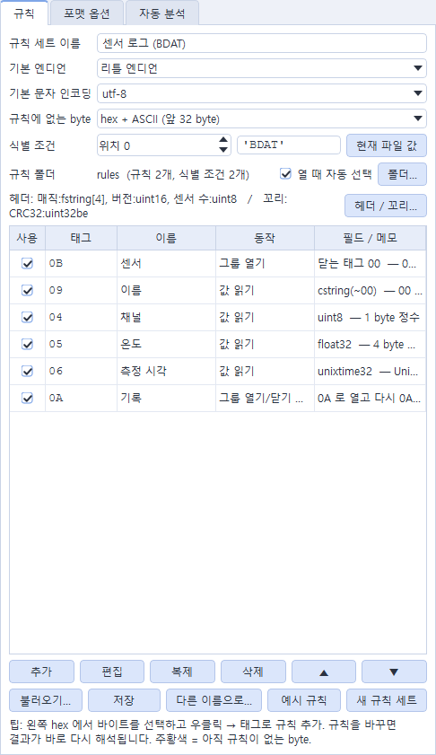

### 규칙 세트 설정 (탭 위쪽)

| 항목 | 설명 |
|---|---|
| 규칙 세트 이름 | 저장할 때 파일 이름의 기본값 |
| 기본 엔디언 | 2 byte 이상 숫자의 byte 순서. 필드마다 따로 바꿀 수 있음 |
| 기본 문자 인코딩 | 문자열을 읽을 때 쓰는 인코딩. ascii, utf-8, cp949, euc-kr, utf-16-le/be, shift_jis 등 |
| 규칙에 없는 byte | 어떤 규칙에도 맞지 않는 byte 를 어떻게 보여 줄지 (아래 표) |
| 최대 그룹 깊이 | 그룹이 이 단계(기본 100)보다 깊게 열리면 해석을 멈춤 → [그룹이 끝없이 겹칠 때](#그룹이-끝없이-겹칠-때-최대-그룹-깊이) |
| 식별 조건 | 이 규칙 세트가 맞는 파일을 알아보는 조건 → [9장](#9-규칙-폴더와-자동-선택) |
| 규칙 폴더 | 규칙 세트 JSON 을 모아 둔 폴더 → [9장](#9-규칙-폴더와-자동-선택) |
| 헤더 / 꼬리 | 위치로 정해지는 파일 앞뒤 구조 → [5장](#5-헤더와-꼬리) |

| 규칙에 없는 byte | 결과 |
|---|---|
| hex + ASCII (앞 32 byte) | `?? 5 byte: 05 66 66 12 42  \|.ff.B\|` (기본값) |
| hex + ASCII 전체 | 16 byte 씩 줄을 나눠 전부 표시. 헤더·꼬리처럼 긴 부분을 자세히 볼 때 |
| byte 수만 표시 | `?? 5 byte` |
| 해석 중단 | 처음 만난 곳에서 해석을 멈춤 |

### 규칙 표와 버튼

- **사용** 체크를 끄면 그 규칙만 잠시 빼고 해석합니다. 규칙 하나가 결과에 어떤 영향을 주는지 볼 때 편합니다.
- 행을 더블클릭하거나 **편집** 을 누르면 규칙 편집 창이 열립니다.
- **추가 / 복제 / 삭제 / ▲ ▼** (순서 변경), **불러오기… / 저장 / 다른 이름으로…** (JSON 파일),
  **예시 규칙**, **새 규칙 세트** (빈 규칙).
- 저장하지 않은 변경이 있는 상태에서 다른 규칙을 불러오면 저장할지 먼저 묻습니다.

### 가장 빠른 규칙 추가: hex 에서 우클릭

hex 보기에서 태그가 될 byte 를 선택하고 우클릭 → **선택한 바이트 [..] 를 태그로 규칙 추가…** 를 누르면
그 byte 가 태그로 채워진 규칙 편집 창이 열립니다.

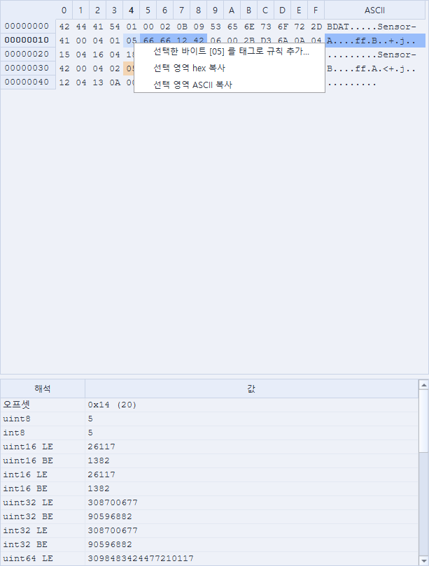

### 규칙 편집 창

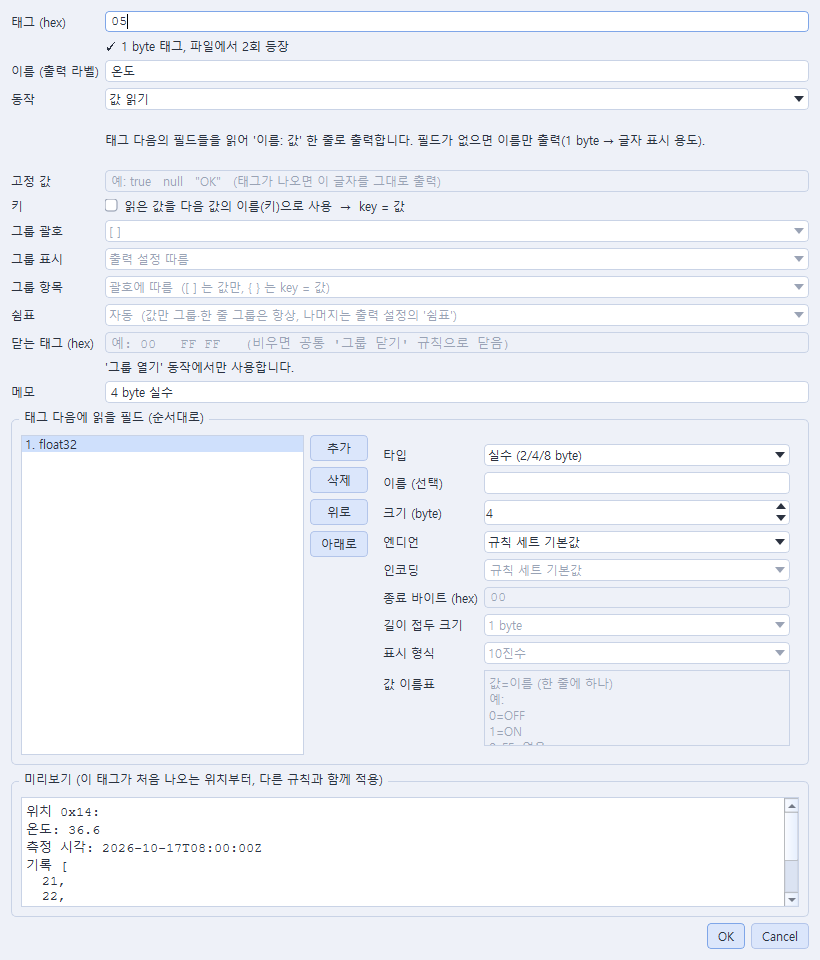

| 항목 | 설명 |
|---|---|
| 태그 (hex) | `09`, `5F 20` 처럼 1 byte 이상. `??` 는 아무 byte (예: `5F ??`), `'BDAT'` 처럼 따옴표로 ASCII 도 가능. 아래에 파일에서 몇 번 나오는지 표시 |
| 이름 | 결과에 나올 이름 |
| 동작 | 태그를 만났을 때 할 일 (아래 표) |
| 고정 값 | "고정 값" 동작일 때 출력할 글자 (예: `true`, `null`, `"OK"`) |
| 그룹 괄호 | 그룹일 때 `[ ]` 또는 `{ }` |
| 그룹 표시 | 그룹일 때 항목을 줄마다 / 한 줄로 쓸지. 기본은 출력 설정 따름 → [그룹마다 표시 방법 정하기](#그룹마다-표시-방법-정하기) |
| 그룹 항목 | 그룹 안 항목을 `key = 값`(이름 표시)으로 쓸지, 값만 쓸지. 기본은 괄호에 따름 → [그룹 항목](#그룹-항목-key--값-또는-값만) |
| 쉼표 | 그룹 안 항목 사이의 쉼표: 자동 / 넣음 / 안 넣음 → [그룹마다 쉼표 정하기](#그룹마다-쉼표-정하기) |
| 닫는 태그 | "그룹 열기" 일 때 이 그룹을 닫는 byte (예: `00`) |
| 메모 | 자유롭게 적는 설명 |
| 태그 다음에 읽을 필드 | 태그 뒤에 순서대로 읽을 값들. 하나도 없으면 이름만 출력 |
| 미리보기 | 이 태그가 처음 나오는 위치부터, 다른 규칙과 함께 적용한 결과. 설정을 바꾸면 바로 갱신 |

태그가 여러 규칙에 맞으면 **더 긴 태그**(더 구체적인 것)가 우선합니다. 예: `5F 20` 이 `5F` 보다 우선.

#### 동작

| 동작 | 설명 | 예 |
|---|---|---|
| 값 읽기 | 필드를 읽어 `이름: 값` 한 줄 출력 | `04` → 1 byte 정수 |
| 고정 값 | 뒤의 byte 를 읽지 않고 **고정 값** 에 적은 글자를 그대로 출력 | `01` → `true`, `02` → `null` |
| 그룹 열기 | 그룹을 열고 안쪽을 들여씀. **닫는 태그**를 지정하면 그 byte 가 나올 때 닫힘 | `0B` … `00` |
| 그룹 닫기 (공통) | 가장 안쪽 그룹을 닫음 (닫는 태그를 따로 정하지 않은 그룹용) | `0C` |
| 그룹 열기/닫기 (같은 태그) | 처음 나오면 열고, 다시 나오면 닫음 | `0A` 배열 `0A` |
| 길이 블록 | 첫 필드 = 길이. 그만큼의 byte 를 안쪽 그룹으로 해석 | `01` + 2 byte 길이 |
| 개수 블록 | 첫 필드 = 항목 수. 그만큼의 항목을 안쪽 그룹으로 해석 | `02` + 1 byte 개수 |
| 해석 종료 | 여기서 해석을 멈추고 나머지는 미해석 byte 로 | 파일 끝 표시 |

#### 그룹을 다른 byte 로 닫기 (닫는 태그)

`0B` 로 열고 `00` 으로 닫는 객체처럼, 여는 byte 와 닫는 byte 가 다른 구조는 **그룹 열기** 에 **닫는 태그** 를 지정합니다.

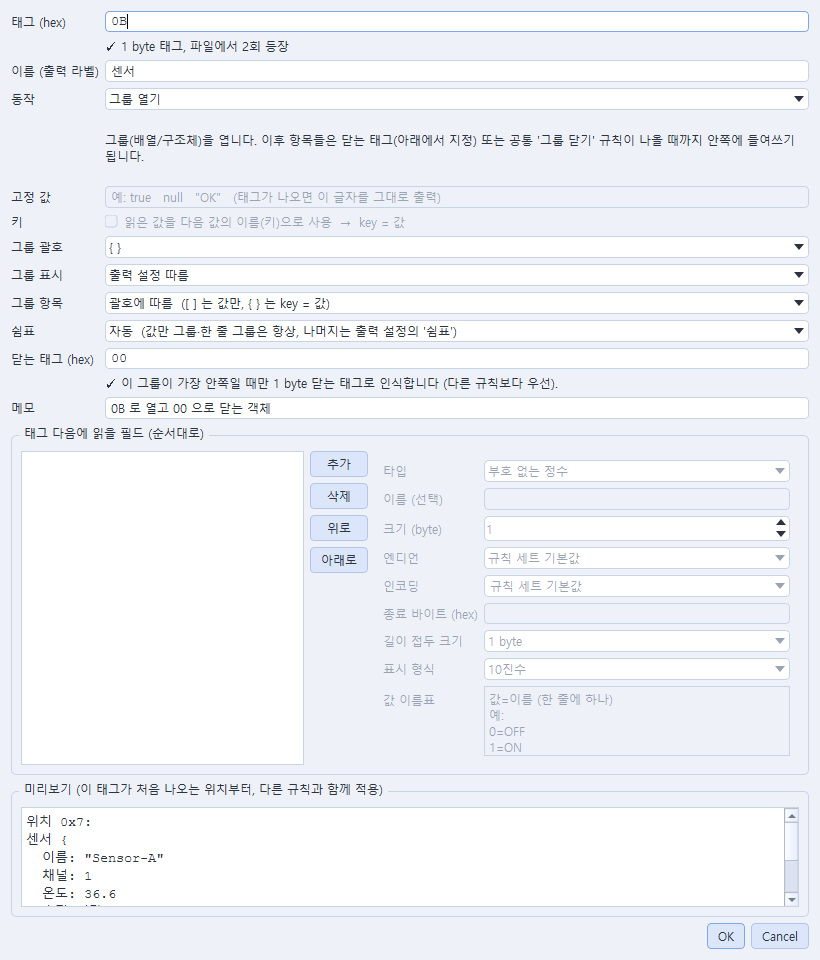

- 닫는 태그는 **그 그룹이 가장 안쪽일 때만** 닫는 byte 로 인식합니다. 그래서 같은 `00` 이 다른 곳에서는 다른 의미여도 괜찮습니다.
- 안쪽 문자열(`09 … 00`)의 `00` 은 문자열 필드가 먼저 읽으므로 그룹을 닫지 않습니다.
- 그룹 안에 그룹이 있어도 각자 자기 짝을 찾아 닫힙니다.

#### 그룹이 끝없이 겹칠 때 (최대 그룹 깊이)

닫는 태그를 잘못 정하면(예: 실제로는 `00` 으로 닫히는데 `FF FF` 로 지정) 그룹이 닫히지 않습니다.
그러면 여는 태그가 나올 때마다 앞 그룹 **안에** 새 그룹이 열려 한 단계씩 깊어집니다.
규칙 세트의 **최대 그룹 깊이**(기본 100)를 넘으면 그 자리에서 해석을 멈추고 다음 오류를 보여 줍니다.

```
!! 오류: 그룹이 100단계보다 깊어져 해석을 멈춥니다 — 그룹을 닫는 태그나 그룹 규칙이 맞는지 확인하세요
```

이 오류가 보이면 닫는 태그나 그룹 규칙을 고치세요. 정말로 100단계보다 깊은 구조라면 규칙 탭의
**최대 그룹 깊이** 값을 올리면 됩니다. 이 값은 규칙 세트 JSON 에 함께 저장됩니다.

#### 태그를 정해진 글자로 바꾸기 (고정 값)

`01` 이 나오면 true, `02` 가 나오면 null 처럼 **태그 자체가 값**인 구조는 동작을 **고정 값** 으로 하고
**고정 값** 칸에 출력할 글자를 적습니다. 태그 뒤의 byte 는 읽지 않습니다.

```
01  →  켜짐: true          (이름을 끄면 true)
09 "on" 00  01  →  on = true   (키 규칙 다음에 오면 키의 값이 됨)
```

- 적은 글자를 그대로 씁니다. 따옴표가 필요하면 `"OK"` 처럼 직접 넣으세요(출력 설정의 **따옴표** 를 끄면 빠짐).
- 태그 뒤에 의미 없는 byte 가 붙어 있으면 필드에 **건너뛰기** 를 넣어 그만큼 건너뜁니다(표시 안 함).
- **키** 를 체크하면 그 글자가 다음 값의 이름이 됩니다: `20` → `id` 키로 정하면 `20 04 07` → `id = 7`.

#### 필드 타입

| 타입 | 설명 | 주요 설정 |
|---|---|---|
| 부호 없는 정수 / 부호 있는 정수 | 1~8 byte | 크기, 엔디언, 표시 형식(10진/16진/둘 다/2진), 값 이름표 |
| 실수 | 2/4/8 byte (half/float/double) | 크기, 엔디언 |
| 불리언 | 0 = false, 나머지 = true | 크기 |
| 문자열 (종료 바이트까지) | `00` 같은 종료 byte 까지 | 종료 바이트, 인코딩 |
| 고정 길이 문자열 | 정해진 byte 수 | 크기, 인코딩 |
| 길이 접두 문자열 | 앞의 1/2/4 byte 또는 varint 가 길이 | 길이 접두 크기, 인코딩 |
| 고정 길이 바이트 / 길이 접두 바이트 | hex 로 표시 | 크기 또는 길이 접두 크기 |
| BCD 숫자 | 1 byte 에 숫자 2개 (예: `20 26` → 2026) | 크기 |
| varint / zigzag varint | 가변 길이 정수 (LEB128) | – |
| Unix 시각 | 1970-01-01 부터의 초 또는 밀리초 → 날짜·시각 | 크기, 표시 형식(초/ms) |
| 건너뛰기 | 읽기만 하고 표시 안 함 (예약 영역) | 크기 |
| 블록/파일 끝까지 전부 | 남은 byte 전부 | – |

**값 이름표**: 정수 값에 이름을 붙입니다. 한 줄에 `값=이름` 하나씩 (예: `0=OFF`, `1=ON`, `0xFF=없음`).
결과에 `상태: ON (1)` 처럼 나옵니다.

### 파일 속 문자열을 키로 쓰기 (key = 값)

설정 파일처럼 **키 이름이 파일 안에 문자열로 들어 있고 바로 뒤에 그 값이 오는** 구조가 있습니다.

```
09 "volume" 00  04 1E          →  volume = 30
09 "mode" 00    09 "auto" 00   →  mode = "auto"   ('따옴표' 를 끄면 mode = auto)
```

이때는 문자열 규칙(위의 `09`)을 편집해서 **키** 의 **"읽은 값을 다음 값의 이름(키)으로 사용"** 을 체크합니다.
"값 읽기" 와 "고정 값" 동작에서 쓸 수 있습니다.

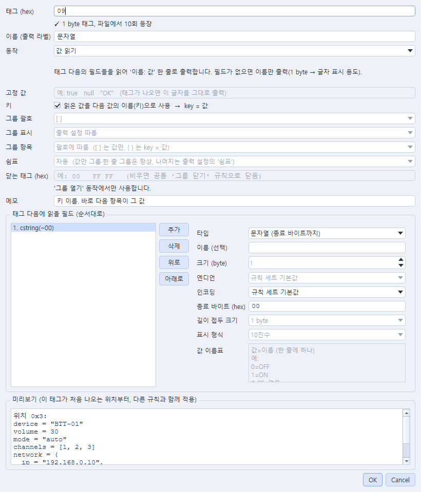

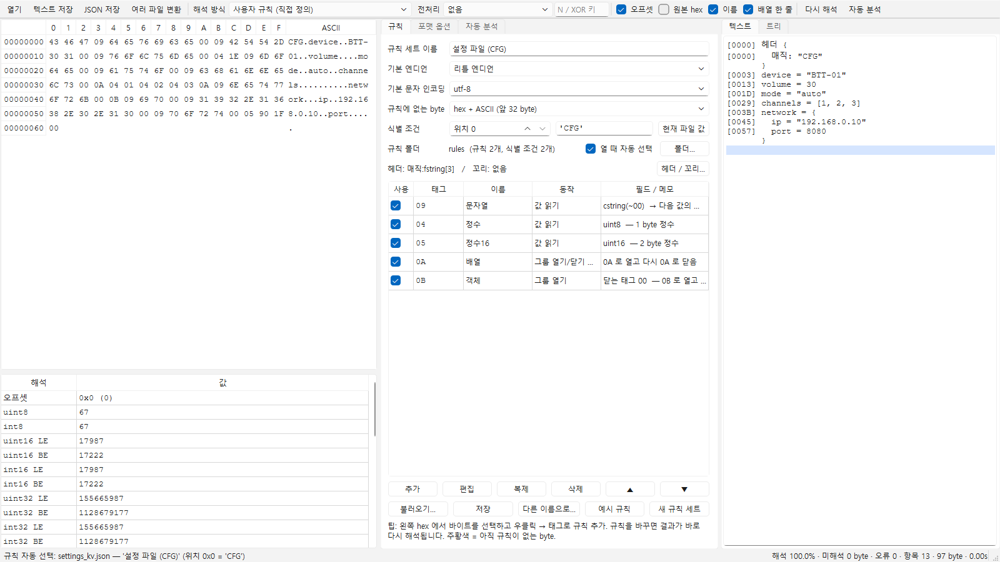

- 키 바로 다음에 오는 항목이 값이 됩니다. 값은 정수, 문자열, 배열(`channels = [1, 2, 3]`), 객체(`network = { … }`) 모두 됩니다.
- 키와 값이 **같은 태그**여도 됩니다. 키 다음에 같은 규칙이 또 나오면 그것은 값으로 읽습니다 (`mode = "auto"`).
- **값만 쓰는 그룹(기본: 배열 `[ ]`) 안에서는 키로 쓰지 않습니다.** 키 규칙도 평범한 값으로 읽습니다:
  `09 "list" 00 0A 09 "a" 00 09 "b" 00 0A` → `list = ["a", "b"]`.
  배열 안에서도 `key = 값` 으로 쓰고 싶으면 그 배열 규칙의 **그룹 항목** 을 **key = 값** 으로 바꾸세요.
- 문자열 값의 따옴표는 출력 설정의 **따옴표** 로 정합니다. 켜면 `mode = "auto"`, 끄면 `mode = auto`.
  빈 문자열은 켜든 끄든 `mode = ""` 입니다. JSON 저장에는 항상 원래 값이 들어갑니다.
- 이 기능은 **규칙마다 켜는 옵션**이고 기본은 꺼져 있습니다. 키를 체크한 규칙에만 적용됩니다.
- 키 다음에 미해석 byte 가 끼어 있거나 값 없이 그룹이 끝나면, 그 키는 평범한 `문자열: "…"` 줄로 남습니다.
- **개수 블록** 안에서는 키와 값을 합쳐 한 항목으로 셉니다. "항목 2개" 인 맵이면 키·값 쌍 2개를 읽습니다.
- 결과 줄을 클릭하면 hex 에서 키부터 값까지가 함께 표시됩니다.
- 예제: `examples\manual\settings.bin` + `examples\manual\rules\settings_kv.json`

### 그룹마다 표시 방법 정하기

그룹 규칙(그룹 열기, 그룹 열기/닫기, 길이 블록, 개수 블록)의 편집 창에는 **그룹 표시** 가 있습니다.

| 그룹 표시 | 결과 |
|---|---|
| 출력 설정 따름 | 출력 설정의 **그룹** 대로 (기본) |
| 줄마다 | 출력 설정과 상관없이 이 그룹은 항목마다 줄바꿈 |
| 한 줄로 | 출력 설정과 상관없이 이 그룹은 쉼표로 이어 한 줄로 |

예를 들어 출력 설정은 **줄마다 + 쉼표** 로 두고 `0A 배열` 규칙만 **한 줄로** 하면 다음처럼 됩니다.

```
network = {
  ip = "192.168.0.10",
  port = 8080,
  channels = [1, 2, 3]
}
```

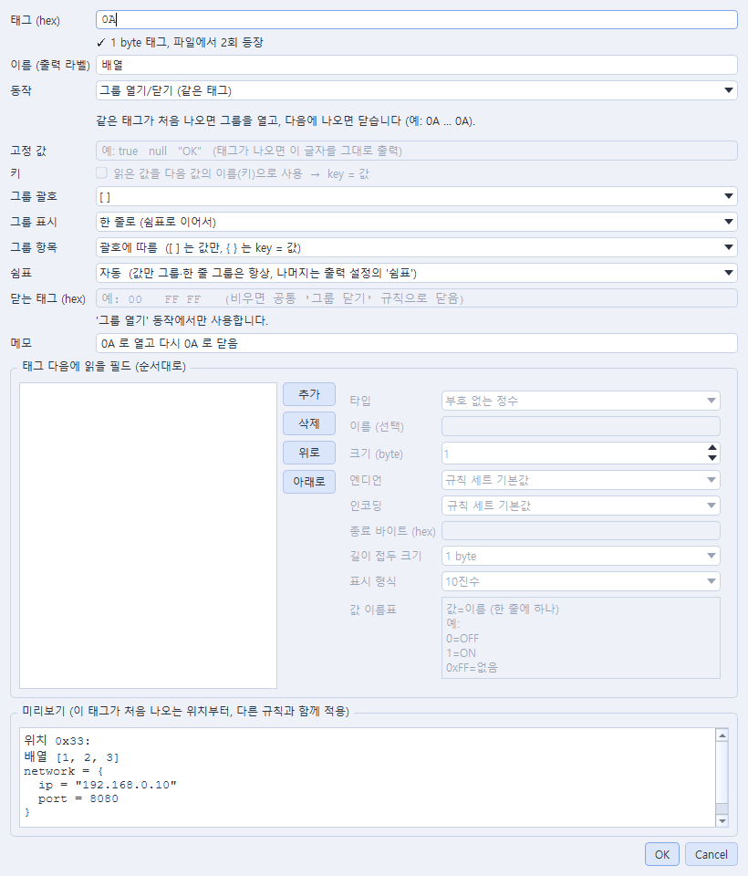

이 설정은 규칙 JSON 에 함께 저장되므로, 그 파일 형식에 맞는 모양이 규칙 세트와 함께 유지됩니다.
미리보기에는 출력 설정(이름, 따옴표, 쉼표, 그룹, 실수 유효 숫자)이 그대로 적용됩니다.

### 그룹 항목: key = 값 또는 값만

그룹 규칙의 편집 창에서 **그룹 항목** 으로 그 그룹 안의 항목을 어떻게 쓸지 정합니다.

| 그룹 항목 | 결과 | 예 |
|---|---|---|
| 괄호에 따름 (기본) | `[ ]` 는 값만, `{ }` 는 `key = 값` | `channels = [1, 2, 3]`, `network = {ip = …, port = 8080}` |
| key = 값 | 괄호와 상관없이 키 규칙이 `key = 값` 이 되고 규칙 이름(`채널: 1`)도 씀 | `[a = 1, b = 2]` |
| 값만 | 괄호와 상관없이 값만 쉼표로 나열. 키 규칙도 평범한 값으로 읽음 | `{"k", 5, 6}` |

- 값만 쓰는 그룹은 쉼표 체크와 상관없이 항목 사이에 항상 쉼표를 넣습니다(아래 **쉼표** 로 바꿀 수 있음).
- 그룹 괄호(`[ ]` / `{ }`)는 보이는 괄호 모양만 정하고, 항목을 어떻게 쓸지는 이 설정이 정합니다.
- 내장 포맷(MessagePack 등)은 괄호에 따릅니다: 배열은 값만, 맵·객체는 `key: 값`.

### 그룹마다 쉼표 정하기

그룹 규칙의 편집 창에서 **쉼표** 로 그 그룹 항목 사이의 쉼표를 정합니다. 마지막 항목 뒤에는 붙지 않습니다.

| 쉼표 | 결과 |
|---|---|
| 자동 (기본) | 값만 쓰는 그룹(배열)과 한 줄로 쓰는 그룹은 항상 쉼표, 나머지는 출력 설정의 **쉼표** 체크를 따름 |
| 넣음 | 체크와 상관없이 항상 쉼표 |
| 안 넣음 | 체크와 상관없이 쉼표 없음. 한 줄로 쓰면 공백으로만 구분: `기록 [21 22 24]` |

출력 설정의 **쉼표** 체크는 "자동" 인 그룹들과 내장 포맷에 적용되는 기본값입니다. 쉼표 체크를 바꿔도
결과가 그대로라면, 그 그룹이 값만 쓰는 그룹(배열)이거나 한 줄 그룹이거나, 규칙에서 쉼표를 정해 둔 것입니다.

---

## 5. 헤더와 꼬리

파일 맨 앞(헤더)과 맨 끝(꼬리)처럼 **태그 없이 위치로 정해지는 부분**은 규칙 탭의 **헤더 / 꼬리…** 에서 정합니다.

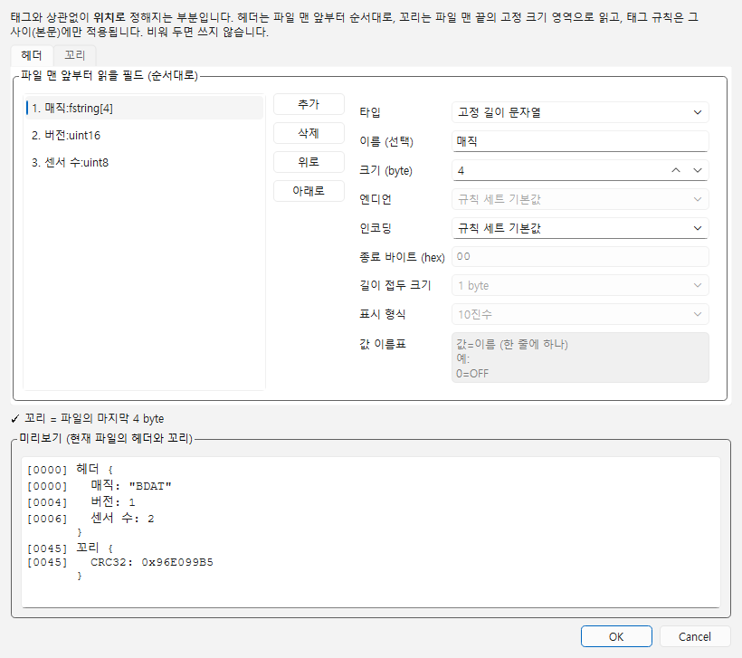

- **헤더**: 파일 맨 앞부터 필드를 순서대로 읽습니다. 예: 매직 4 byte, 버전 2 byte, 센서 수 1 byte.
- **꼬리**: 파일 맨 끝의 고정 크기 영역입니다. 예: CRC32 4 byte. 길이가 정해지지 않은 필드(종료 문자열 등)는 꼬리에 쓸 수 없습니다.
- 태그 규칙은 헤더와 꼬리 **사이(본문)** 에만 적용됩니다. 그래서 꼬리의 CRC 값이 우연히 태그와 같아도 잘못 해석되지 않습니다.
- 아래 미리보기에 현재 파일의 헤더와 꼬리만 표시됩니다.
- 결과에는 `헤더 { … }`, `꼬리 { … }` 그룹으로 나옵니다. 결과 위 출력 설정의 **헤더/꼬리** 를 끄면 출력과 저장 파일에서 뺍니다.

---

## 6. 모르는 파일 해독하기 (반복 작업)

규칙을 모르는 파일은 다음 과정을 반복하면서 규칙을 늘려 갑니다.

1. 파일을 열고 결과에서 `??` 줄과 hex 의 **주황색 byte** 를 봅니다. 아직 설명되지 않은 부분입니다.
2. 주황색 부분의 첫 byte 들이 반복되는 패턴인지 봅니다. 문자열 바로 앞, 같은 간격으로 나오는 byte 는 태그일 가능성이 높습니다.
3. 데이터 해석기로 태그 다음 byte 가 정수·실수·시각 중 무엇인지 확인합니다.
4. hex 에서 우클릭 → 태그로 규칙 추가. 미리보기를 보면서 필드를 맞춥니다.
5. 해석률이 올라가는지 확인하고, 1번으로 돌아갑니다.

아래는 예제 파일에서 **온도(`05`) 규칙을 꺼 본** 화면입니다. 해석하지 못한 5 byte 가 주황색으로 표시되고,
결과에 `?? 5 byte: 05 66 66 12 42` 로 나옵니다. 해석률도 100% → 86.3% 로 내려갑니다.

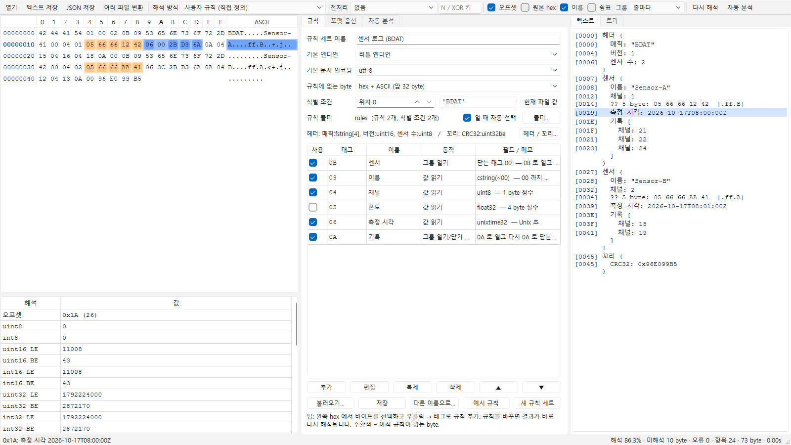

> 규칙에 맞지 않은 byte 는 **버려지지 않습니다**. 위 형식으로 결과에 그대로 남으므로, 텍스트 결과만 보고도
> 어디가 아직 해석되지 않았는지 알 수 있습니다.

---

## 7. 자동 분석 (F6)

처음 보는 파일은 **자동 분석** 탭에서 **분석 실행 (F6)** 을 눌러 단서를 얻습니다.

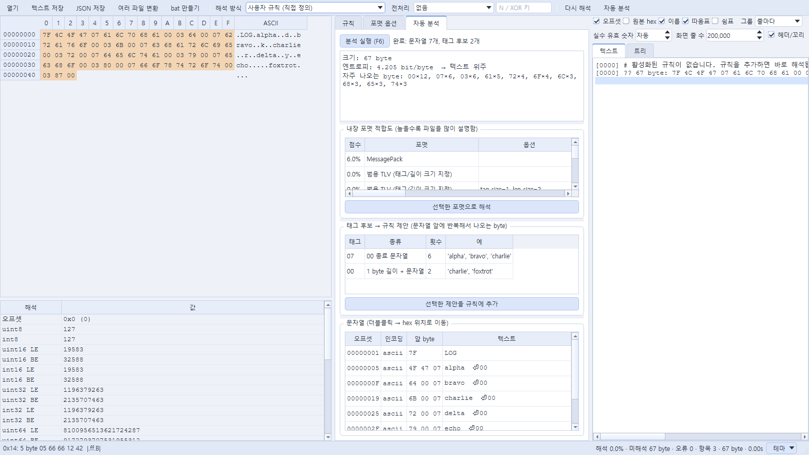

| 영역 | 내용 |
|---|---|
| 요약 | 크기, 엔트로피(압축·암호화 여부 추정), 자주 나오는 byte, 파일 시그니처(40여 종), 가능한 전처리, 고정 길이 레코드 크기 후보 |
| 내장 포맷 적합도 | 모든 내장 포맷을 시도해 "파일을 오류 없이 얼마나 설명하는가" 순으로 정렬. 더블클릭하면 그 포맷으로 해석 |
| 태그 후보 → 규칙 제안 | 문자열 바로 앞에 반복해서 나오는 byte. `00 종료 문자열`, `1 byte 길이 + 문자열`, `2 byte 길이 + 문자열` 중 어울리는 형태를 제안 |
| 문자열 | ASCII/UTF-8/UTF-16/CP949 문자열과 그 앞 3 byte. 더블클릭하면 hex 위치로 이동 |

위 화면에서는 `07` 이 6번, 모두 `00` 으로 끝나는 문자열 앞에 나왔습니다. 이 행을 선택하고
**선택한 제안을 규칙에 추가** 를 누르면 규칙이 만들어지고 바로 다시 해석됩니다.

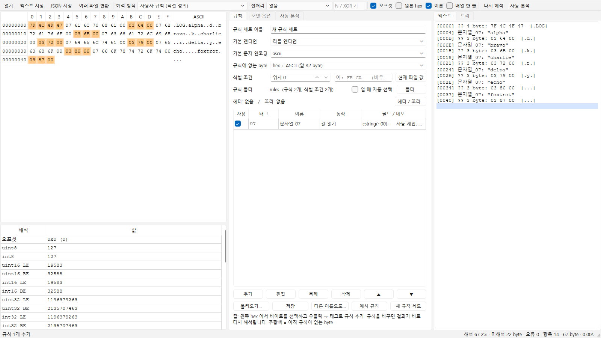

해석률이 0% → 67% 로 올랐습니다. 남은 `?? 3 byte: 03 64 00` 같은 부분은 `03` 다음 2 byte 정수로 보이므로,
[6장](#6-모르는-파일-해독하기-반복-작업)의 방법으로 규칙을 하나 더 추가하면 됩니다.

---

## 8. 내장 포맷으로 해석하기

이미 알려진 형식의 파일은 툴바 **해석 방식** 에서 포맷을 고릅니다. 고르면 **포맷 옵션** 탭에 그 포맷의 설정이 나옵니다.

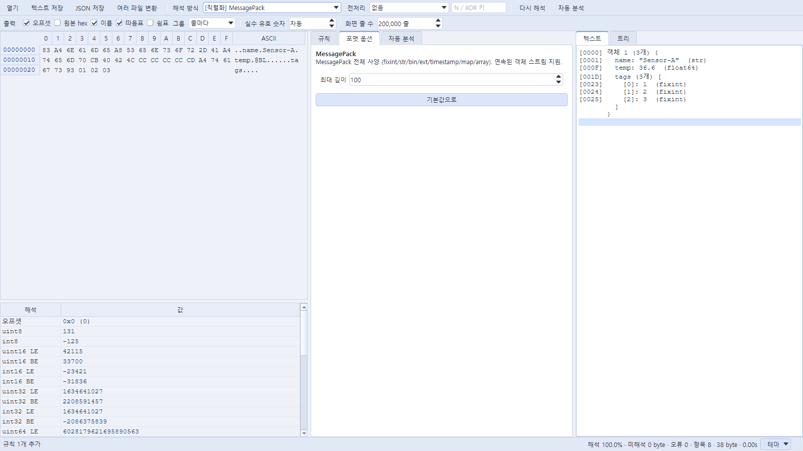

| 분류 | 포맷 |
|---|---|
| TLV | 범용 TLV / LTV / LV (태그·길이 크기, 엔디언 지정), BER/DER (ASN.1, PEM 자동 해제), EMV |
| 직렬화 | Protocol Buffers (스키마 없이), MessagePack, CBOR, BSON, UBJSON, bencode, Thrift (Binary/Compact) |
| 기본 | Hex 덤프, 문자열 추출 |

**전처리** (툴바): 해석 전에 데이터를 변환합니다. 사용자 규칙과 내장 포맷 모두에 적용됩니다.

| 전처리 | 용도 |
|---|---|
| 앞부분 N byte 건너뛰기 | 알려진 형식 앞에 붙은 자체 헤더 제거 (오른쪽 칸에 N) |
| zlib / raw deflate / gzip / bzip2 / xz 압축 해제 | 압축된 파일 |
| Base64 텍스트 → 바이트, hex 텍스트 → 바이트 | 텍스트로 저장된 바이너리 |
| XOR (키 hex) | 단순 XOR 로 가려진 데이터 (오른쪽 칸에 키, 예: `5A` 또는 `12 34`) |

> 전처리를 쓰면 오프셋은 **변환된 데이터** 기준입니다.

---

## 9. 규칙 폴더와 자동 선택

같은 종류의 파일이 여러 형식으로 있을 때, 규칙 세트마다 **식별 조건**을 넣어 두면 파일을 열 때 맞는 규칙 세트가 자동으로 적용됩니다.

### 설정 방법

1. 규칙 탭의 **식별 조건** 에 위치와 byte 값을 넣습니다.
   - 예: 위치 0 = `'BDAT'` (ASCII), 위치 0 = `FE CA`, 위치 4 = `01 ?? 02` (`??` = 아무 byte).
   - **현재 파일 값** 버튼을 누르면 열린 파일의 그 위치 4 byte 가 채워집니다.
2. 규칙 세트를 저장합니다. 이런 규칙 JSON 들을 한 폴더에 모읍니다.
3. **규칙 폴더** 의 **폴더…** 로 그 폴더를 지정합니다. 오른쪽에 규칙 세트 수와 식별 조건이 있는 수가 표시됩니다.
4. **열 때 자동 선택** 이 켜져 있으면 끝입니다.

### 동작

- 파일을 열면 식별 조건이 맞는 규칙 세트로 바뀌고, 상태 표시줄에 알려 줍니다.
  예: `규칙 자동 선택: sensor_log.json — '센서 로그 (BDAT)' (위치 0x0 = 'BDAT')` ([2장 화면](#2-화면-구성) 아래쪽)
- 여러 개가 맞으면 **고정 byte 가 더 많은 조건**이 이깁니다. 예: `FE CA 02` (v2 전용)가 `FE CA` (공통)보다 우선.
- 맞는 것이 없으면 지금 규칙을 그대로 씁니다.
- 지금 규칙에 저장하지 않은 변경이 있으면 바꾸기 전에 **저장 / 버리기 / 취소** 를 묻습니다. 취소하면 지금 규칙을 유지합니다.

---

## 10. 결과 저장

| 버튼 | 결과 |
|---|---|
| **텍스트 저장** (Ctrl+S) | 화면의 텍스트 결과를 `.txt` 로 저장 (UTF-8). 기본 이름은 원본 옆의 `원본이름.확장자.txt`, 폴더와 이름은 자유롭게 변경 |
| **JSON 저장** | 오프셋·길이·종류까지 담은 트리를 JSON 으로 저장. 다른 프로그램으로 후처리할 때 |

- 화면에는 출력 설정의 **화면 줄 수**(기본 20만 줄)까지만 보이지만, 저장 파일에는 **전체 결과**가 들어갑니다.
- 출력 설정의 **오프셋 / 원본 hex / 이름 / 따옴표 / 쉼표 / 그룹 / 실수 유효 숫자** 가 저장 파일에도 그대로 적용됩니다.
- 저장은 뒤에서 진행되고, 상태 표시줄에 "저장 중…" 이 나옵니다. 끝나면 저장한 줄 수가 나옵니다.
  예를 들어 **이름** 을 끄고 저장하면 라벨 없이 값만 들어 있는 텍스트 파일이 됩니다.

---

## 11. 여러 파일 한 번에 변환

툴바 **여러 파일 변환** (Ctrl+B) 을 누르거나, 창이나 exe 아이콘에 파일 여러 개 또는 폴더를 끌어다 놓습니다.

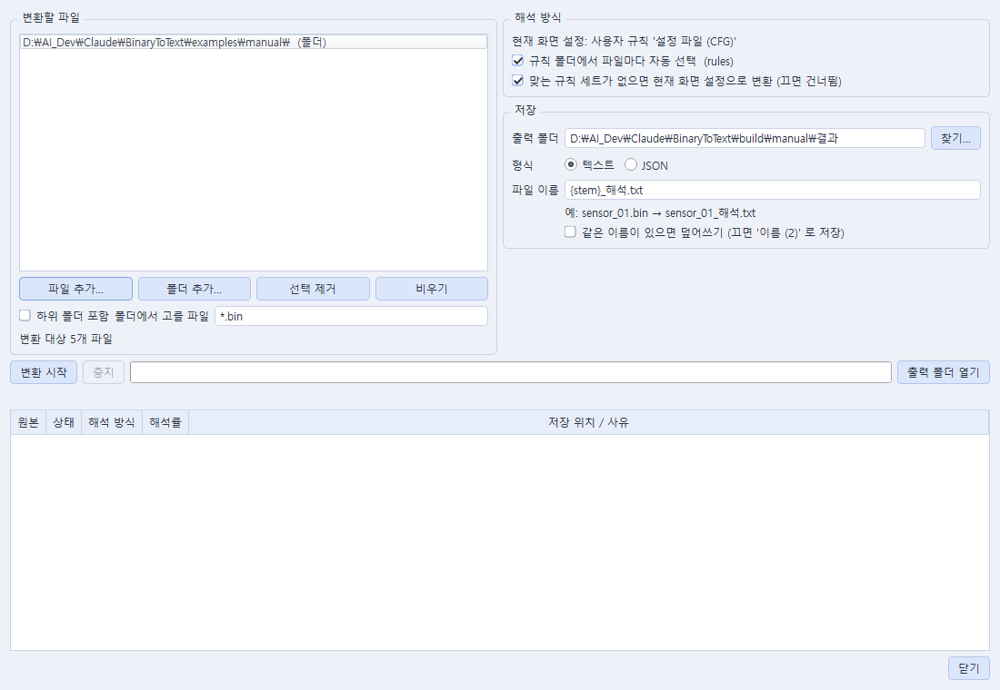

### 변환할 파일 (왼쪽)

- **파일 추가… / 폴더 추가…** 또는 목록으로 끌어다 놓기.
- 폴더를 넣으면 그 안의 파일을 고릅니다. **하위 폴더 포함** 을 켜면 하위 폴더까지, 출력도 같은 폴더 구조로 저장합니다.
- **폴더에서 고를 파일**: `*.bin;*.dat` 처럼 `;` 로 여러 패턴. 출력 폴더 안의 파일은 다시 고르지 않습니다.
- 아래에 변환 대상 파일 수가 표시됩니다.

### 해석 방식 (오른쪽 위)

- 기본은 **지금 화면의 설정** 그대로입니다: 사용자 규칙 또는 내장 포맷과 옵션, 전처리, 오프셋·원본 hex 표시.
- **규칙 폴더에서 파일마다 자동 선택** 을 켜면 파일마다 식별 조건이 맞는 규칙 세트를 씁니다.
- 맞는 규칙 세트가 없는 파일은 현재 화면 설정으로 변환하거나, 체크를 끄면 건너뜁니다.

### 저장 (오른쪽 가운데)

| 항목 | 설명 |
|---|---|
| 출력 폴더 | 비우면 각 원본 파일 옆에 저장 |
| 형식 | 텍스트 또는 JSON |
| 파일 이름 | `{name}` = 원본 이름(확장자 포함), `{stem}` = 확장자 뺀 이름, `{ext}` = 확장자. 아래에 예시가 표시됨. 예: `{stem}_해석.txt` → `sensor_01_해석.txt` |
| 덮어쓰기 | 끄면(기본) 같은 이름이 있을 때 `이름 (2).txt` 로 저장. **원본 파일은 어떤 경우에도 덮어쓰지 않음** |

### 실행과 결과

**변환 시작** 을 누르면 진행 막대와 함께 변환되고, 파일마다 결과가 표에 나옵니다.

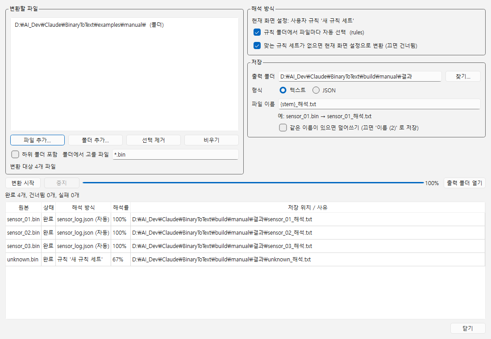

- 상태: **완료 / 건너뜀 / 실패**. 한 파일이 실패해도 나머지는 계속 변환합니다.
- **해석 방식** 열에서 파일마다 어떤 규칙이 쓰였는지 볼 수 있습니다. 위 화면에서 `sensor_*.bin` 은 규칙 폴더의
  `sensor_log.json` 이, `settings.bin` 은 `settings_kv.json` 이 자동으로 선택됐고,
  맞는 규칙이 없는 `unknown.bin` 은 현재 화면 규칙으로 변환됐습니다(그래서 해석률이 낮음).
- **해석률** 이 낮은 파일의 줄을 두 번 클릭하면 그 원본이 메인 창에서 열립니다. 바로 규칙을 손볼 수 있습니다.
- **중지** 는 지금 파일까지 처리하고 멈춥니다. **출력 폴더 열기** 는 탐색기로 결과 폴더를 엽니다.
- 출력 폴더, 이름 형식 등의 설정은 다음에 열 때도 남아 있습니다.

---

## 12. 명령줄 (btt.exe)

`BinaryToText` 폴더의 `btt.exe` 는 화면 없이 같은 기능을 씁니다. 배치 파일이나 스크립트에서 쓰기 좋습니다.

```bat
:: 규칙 JSON 으로 해석해 파일로 저장
btt decode data.bin --rules 규칙.json -o 결과.txt

:: 이름(라벨) 없이 값만, 배열은 한 줄로
btt decode data.bin --rules 규칙.json --no-labels --commas --layout arrays -o 값만.txt

:: 규칙 폴더에서 자동 선택
btt decode data.bin --library 규칙폴더 -o 결과.txt

:: 내장 포맷 + 옵션 + 전처리, JSON 으로
btt decode data.bin --format protobuf --opt nested=true --pre zlib --json -o 결과.json

:: 여러 파일: 하위 폴더까지, 규칙 폴더 자동 선택, 없으면 기본.json
btt batch 입력폴더 -r --include "*.bin" --library 규칙폴더 --rules 기본.json -d 출력폴더 --name "{stem}_해석.txt"

:: 자동 분석 보고서, 내장 포맷 목록
btt analyze data.bin
btt formats
```

| 옵션 | 설명 |
|---|---|
| `--rules` / `--format` / `--library` | 해석 방식. batch 에서 `--library` 와 같이 주면 맞는 규칙이 없을 때 쓰임 |
| `--opt KEY=VALUE` | 포맷 옵션 (`btt formats` 로 확인) |
| `--pre`, `--pre-arg` | 전처리 (`skip`, `zlib`, `gzip`, `base64`, `xor` 등)와 인자 |
| `-o` (decode), `-d` (batch) | 출력 파일 / 출력 폴더. 없으면 decode 는 화면에, batch 는 원본 옆에 |
| `--json`, `--no-offsets`, `--raw` | JSON 출력, 오프셋 빼기, 원본 hex 같이 표시 |
| `--no-labels` | 이름(라벨) 없이 값만 |
| `--no-quotes` | 문자열을 따옴표 없이 (빈 문자열 `""` 과 공백·특수문자가 든 문자열은 따옴표 유지) |
| `--commas` | 그룹 안 항목 뒤에 쉼표 |
| `--float-digits N` | 실수를 유효 숫자 N자리로 (0 = 자동) |
| `--no-header-footer` | 규칙 세트의 헤더·꼬리를 출력에서 뺌 |
| `--layout lines\|arrays\|inline` | 그룹 표시: 줄마다(기본) / 배열만 한 줄 / 모든 그룹 한 줄 (규칙의 그룹 표시 설정이 우선) |
| `--name`, `-r`, `--include`, `--overwrite` | batch 전용: 이름 형식, 하위 폴더, 파일 패턴, 덮어쓰기 |

`btt batch` 는 모든 파일이 성공하면 종료 코드 0, 하나라도 건너뛰거나 실패하면 1 을 돌려줍니다.

### bat 파일 만들기 (툴바 **bat 만들기**)

명령줄 옵션을 직접 쓰지 않아도, 지금 화면의 설정 그대로 `btt.exe batch …` 를 실행하는 `.bat` 파일을 만들어 줍니다.
자주 하는 변환을 더블클릭 한 번이나 파일 끌어다 놓기로 할 때 씁니다.

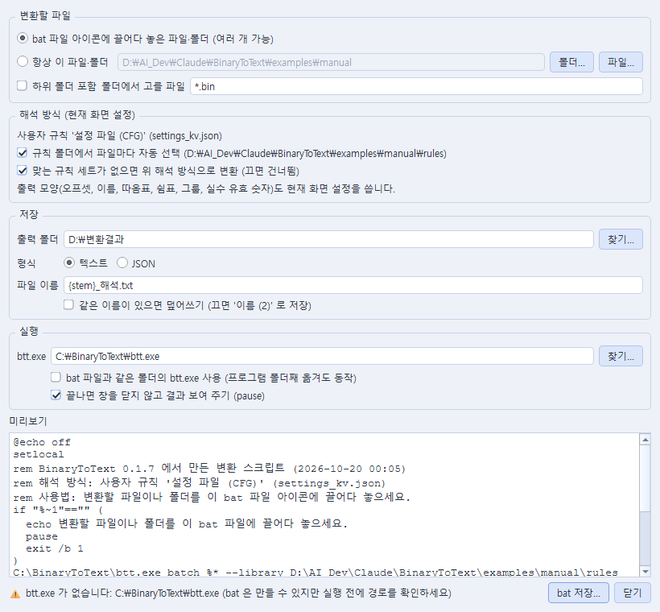

| 항목 | 설명 |
|---|---|
| 변환할 파일 | **끌어다 놓은 파일·폴더**(기본): bat 아이콘에 놓은 것들을 변환. **항상 이 파일·폴더**: 더블클릭하면 정한 경로를 변환 |
| 하위 폴더 / 고를 파일 | 폴더를 넣을 때 하위 폴더까지 볼지, 어떤 파일만 고를지 (`*.bin;*.dat`) |
| 해석 방식 | 현재 화면 설정 그대로: 사용자 규칙(저장된 규칙 JSON) 또는 내장 포맷과 옵션, 전처리. 규칙 폴더를 지정했으면 파일마다 자동 선택도 가능 |
| 출력 모양 | 현재 출력 설정(오프셋, 이름, 따옴표, 쉼표, 그룹, 실수 유효 숫자) 그대로 |
| 저장 | 출력 폴더(비우면 원본 옆), 텍스트/JSON, 파일 이름 형식, 덮어쓰기 |
| btt.exe | 실행할 `btt.exe` 경로(기본: 프로그램 폴더의 btt.exe). **bat 파일과 같은 폴더의 btt.exe 사용** 을 켜면 경로 대신 `%~dp0btt.exe` 를 써서, bat 를 프로그램 폴더에 두면 폴더째 옮겨도 동작 |
| pause | 끝나면 창을 닫지 않고 결과를 보여 줌 |

- 사용자 규칙은 **저장된 규칙 JSON 파일**을 씁니다. 저장하지 않은 변경이 있으면 먼저 저장할지 묻습니다.
  나중에 규칙 JSON 을 고치면 bat 도 고친 규칙으로 변환합니다.
- 아래 **미리보기** 에서 만들어질 내용을 바로 확인할 수 있습니다. 메모장으로 열어 고쳐도 됩니다.
- 한글 경로가 들어가도 동작하도록 cmd 가 읽는 코드 페이지(한국어 Windows 는 CP949)로 저장합니다.
- 만들어진 bat 는 사용자의 파일입니다. 따로 라이선스를 붙일 필요가 없습니다.

---

## 13. 단축키와 참고표

| 단축키 | 동작 |
|---|---|
| Ctrl+O | 파일 열기 |
| Ctrl+S | 텍스트 저장 |
| Ctrl+B | 여러 파일 변환 |
| F5 | 다시 해석 |
| F6 | 자동 분석 |

### 규칙 JSON 파일

규칙 세트는 사람이 읽을 수 있는 JSON 으로 저장됩니다. 메모장으로 고쳐도 되고, 다른 사람과 주고받을 수 있습니다.
예제는 `examples\manual\rules\sensor_log.json`, `examples\request_example.json`, `examples\tlv_style.json` 을 보세요.

### 예제 파일 (`examples\manual\`)

| 파일 | 내용 |
|---|---|
| `sensor_01.bin` ~ `sensor_03.bin` | 헤더(`BDAT` + 버전 + 센서 수), `0B`…`00` 센서 객체, `0A` 배열, 꼬리(CRC32) |
| `rules\sensor_log.json` | 위 파일용 규칙 세트 (식별 조건 `'BDAT'`) |
| `unknown.bin` | 규칙 없이 자동 분석해 보는 파일 (`07` + 문자열, `03` + 2 byte 정수 반복) |
| `profile.msgpack` | 내장 포맷(MessagePack) 예제 |
| `settings.bin` | 키 = 값 구조 예제 (`09` 문자열 키, `04`/`05` 정수, `0A` 배열, `0B`…`00` 객체) |
| `rules\settings_kv.json` | 위 파일용 규칙 세트 (식별 조건 `'CFG'`, `09` 규칙에 키 사용) |
